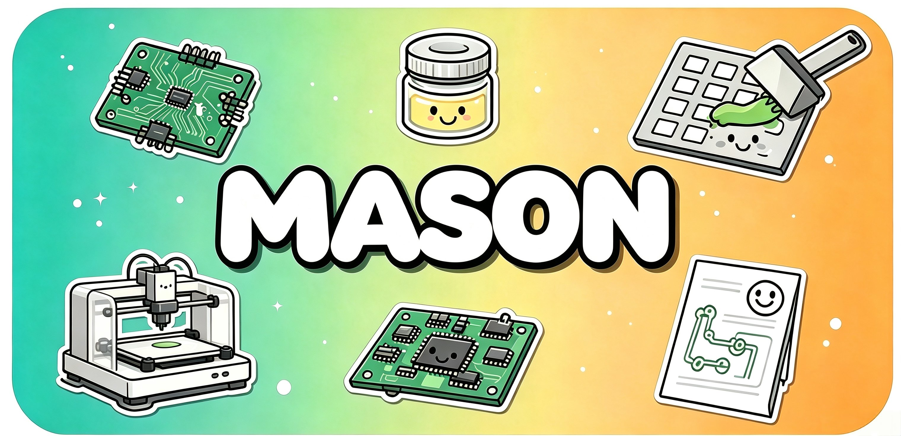

<div align="center">



#  Mason

**Gerber から 3D 印刷ステンシルへ — PCB はんだペースト印刷ツールを生成**
*Gerber 解析 · パラメトリック CAD · リアルタイム 3D プレビュー · ローカル処理*

[🌐 公式サイト](https://ningzixi.github.io/mason/) · [📝 更新履歴](https://github.com/NingZiXi/mason/releases) · [🐛 問題を報告](https://github.com/NingZiXi/mason/issues) · [👤 作者](https://github.com/NingZiXi)

[简体中文](./README.zh-CN.md) · [English](./README.md) · [日本語](./README.ja.md) · [한국어](./README.ko.md)

[](https://github.com/NingZiXi/mason/actions/workflows/ci.yml) [](./LICENSE) [](https://tauri.app) [](https://vuejs.org) [](https://www.rust-lang.org) [](https://www.python.org) [](#開発環境)

### ⬇️ ダウンロード

[](https://github.com/NingZiXi/mason/releases/latest) [](https://github.com/NingZiXi/mason/releases/latest) [](https://github.com/NingZiXi/mason/releases/latest)

> [Releases](https://github.com/NingZiXi/mason/releases/latest) から Windows x64、macOS Apple Silicon、Linux x64 用のインストーラーを選んでください。提供ファイルは各リリースをご確認ください。リリース版はモデリングエンジン内蔵で、Python の別途インストールは不要です。

</div>

---

## 📌 概要

Mason は **Tauri 2 + Python (build123d)** を使ったデスクトップアプリです。JLCPCB / EasyEDA などの Gerber ZIP を読み込み、3D 印刷できるはんだペースト印刷ツールを生成します。試作から小ロット製作まで、2 つのモードで対応します。

- **ステンシル治具モード** — PCB トレイ、B 面ベース、A 面カバーを生成します。金属ステンシルをベースとカバーで挟み、トレイの 4 本の位置決めピンに合わせて下ろして使用します。
- **PCB ステンシルモード** — ペースト層から、PCB ポケットを備えた一体型ステンシルを生成します。別の治具が不要で、試作に適しています。

基本の流れは「Gerber を読み込む → プレビューで確認 → STL を書き出す」です。解析とモデル生成はローカルで行います。

---

## ✨ 機能

### Gerber 解析

- 外形層 (`.GKO` / `Edge.Cuts` / `.GM1`) とペースト層 (`.GTP` / `.GBP`) を自動認識
- RS-274X 解析に対応し、`%LM` のミラー、`%LR` の回転、`%LS` の拡縮を処理
- G02/G03 の円弧、複数行の D コード、異形基板の輪郭を解析
- 円形・長方形・長円形・角丸長方形・多角形・領域塗りのパッドに対応
- 同一基板の配列と異なる基板の混載パネルに対応し、パネル全体または特定の基板を選択可能
- PCB ステンシルモードで有効な外形がない場合はパッド範囲から推定し、推定であることを表示して書き出し前に確認

### ステンシル治具モード

- 下から **PCB トレイ → B 面ベース → 金属ステンシル → A 面カバー** の順に配置
- ベースとカバーが金属ステンシルを挟み、組立品をトレイの 4 本の一体型位置決めピンに沿って下ろす構造
- ねじは A/B 枠の周囲に配置。四隅はねじではなく位置決めピン
- M2.5 / M3 / M3.5 / M4 / M5 のねじ規格に穴径とナット寸法が連動
- ステンシル寸法から治具の外形を 5 mm 刻みで自動算出
- 異形基板のポケットを生成し、組立の隙間を調整可能
- 両面へのペースト印刷：印刷面を選び、下面のパッドから余裕を調整して逃げ領域を推定、または長方形・円形・多角形で描画。自動生成は手動の領域を残して追加し、元に戻せます。実際の部品外形を確認し、深さ指定か貫通を個別・一括で設定。同じ切削方法・深さの選択領域を1つの長方形で囲んで結合し、間の部分も逃がします。基板の支えを残して必要に応じてトレイを厚くします

### PCB ステンシルモード

- PCB 外周のフレーム、基板厚と同じ深さのポケット、底面の薄いステンシル層を一体生成
- パッド開口は薄いステンシル層のみを貫通し、基板外形と位置を合わせて配置
- 長円形パッドを直角の長方形開口に変換
- テストポイント除外は初期状態で有効。Gerber の用途属性、任意の `FlyingProbeTesting.json`、孤立した真円の形状を使って判定。部品ピン・近接円・等間隔の列を保護し、結果はプレビューで確認
- **2D 開口確認**：元のパッド / 生成開口 / 重ねて比較を切り替え、除外理由も確認可能
- **手動開口**：「元のパッド」のみで編集。左クリックか範囲選択で開口・閉鎖・自動に戻すを一括設定。右ドラッグで移動、ホイールで拡縮
- 手動設定は元に戻す・やり直しに対応し、パネル全体と子基板の間で同期
- 狭ピッチパッドの交互配置、大きな開口の格子分割、テーパー開口
- 外形は基板形状または長方形を選択でき、角丸半径も調整可能
- 基板を取り外しやすくする台形の切欠きを配置

### 共通機能

- three.js のリアルタイム 3D プレビュー、バックグラウンド準備と STL キャッシュ
- 高密度パッド向けの高速 STL 生成で、初回表示や設定変更の待ち時間を削減
- **複数プリセット**：デフォルト・カスタム設定のどちらからでも新規保存、変更保存、名前変更、削除が可能
- プリセットの切替前に保存・別名保存・破棄を選択。再起動時は最後に選んだ保存済みプリセットを復元
- プリセットに保存するのは印刷・構造設定のみ。基板の寸法・厚み・Gerber データは含まない
- パラメーターの元に戻す・やり直し。連続操作と連動値をまとめて記録
- 全体組立プレビュー：分解表示、PCB・金属ステンシルの表示切替、位置決めピン・ねじ・ナットの確認
- 台座とリップ幅の平面プレビュー、および周囲のねじ・ナットの推定規格・長さ・数量
- 未確認の金属ステンシル寸法は書き出し前に確認。未書き出しの作業を終了する際にも確認
- 初回操作ガイド、システムに合わせたライト・ダークテーマ
- 簡体字中国語 / 英語 / 日本語 / 韓国語。手動選択またはシステム言語に合わせて選択し、未対応言語は英語にフォールバック
- アプリ内の更新確認・ダウンロード・インストール。起動時の確認は設定で変更可能
- STL / STEP の書き出し。フォルダー名を指定でき、同名の場合は番号を自動追加。全部品の生成成功後に最終フォルダーを作成し、失敗時は今回の一時ファイルを削除

---

## 🛠️ 開発環境

### 必要なツール

| ツール | バージョン | 用途 |
| --- | --- | --- |
| Node.js | 20+ | フロントエンドのビルド |
| Rust | stable | Tauri バックエンドのビルド |
| Python | 3.12 推奨 | 開発版の CAD 生成。現在の CI と同じバージョン |

[Tauri の OS 別ビルド要件](https://v2.tauri.app/start/prerequisites/) を用意し、リポジトリのルートで次を実行してください。

### 開発版の起動

```sh
python -m pip install -r python/requirements.txt
npm ci
npm run tauri:dev
```

アプリはシステム Python を自動検出します。必要なら「Python 環境」で、依存関係をインストール済みのインタープリターを選択してください。`tauri:dev` はホットリロード対応のデスクトップ版を起動します。

### パッケージの作成

先に Python + build123d / Shapely / numpy のランタイムを作成し、次にアプリをビルドします。リリース版の利用者による環境設定は不要です。

```sh
# Windows
npm run build:python-env
npm run tauri:build

# macOS / Linux
bash scripts/build-python-env.sh
npm run tauri:build
```

インストーラーは `src-tauri/target/release/bundle/` に出力します。Windows では `.msi` / `.exe` を使用します。

`tauri.conf.json` のランタイムリソースはディレクトリを配列形式で指定し、`site-packages` の構造を維持してください。詳細は [開発ガイド（英語）](./docs/DEVELOPMENT.en.md) を参照してください。

---

## 📖 使用手順

### ステンシル治具

1. Gerber ZIP をドロップし、パネルなら全体または対象基板を選択します。
2. PCB の寸法・厚みを確認し、金属ステンシルの実際の外形寸法を入力します。
3. ねじ間隔、トレイ厚、ポケットの隙間などを必要に応じて調整します。
4. PCB トレイ・B 面ベース・A 面カバーを個別または全体組立で確認します。
5. STL / STEP と保存先を選び、書き出し名を確認します。その名前のサブフォルダーにモデルを保存します。

### PCB ステンシル

1. 「PCB ステンシル」モードに切り替えます。
2. `.GTP` / `.GBP` などのペースト層を含む Gerber ZIP を読み込みます。
3. 厚みプリセットを選びます。レジン 0.15 mm / 標準 0.2 mm / FDM 0.3 mm。
4. 開口縮小率、フレーム幅、角丸、取り外し切欠きを調整します。
5. 2D 開口確認で位置と除外結果を点検し、必要なら手動変更して 3D モデルを確認します。
6. STL をスライス・印刷用に、または STEP を CAD 編集用に書き出します。

印刷前に実物の寸法、開口、プリンターの組立クリアランスを確認してください。

---

## 🏗️ 技術構成

**Vue 3 + Tauri 2 (Rust) + Python (build123d)** を組み合わせています。

```text
Vue 3 / Pinia / three.js
         ↕ Tauri IPC
       Rust プロセス調停
         ↕ JSON
Python / build123d / Shapely
```

- フロントエンドが Gerber 解析、パラメーター、3D 表示を担当し、IPC で Rust に処理を依頼
- Rust が常駐 Python プロセスを調停し、行単位 JSON プロトコルでモデルを生成
- パラメーターのハッシュで STL をキャッシュし、同じ部品の再計算を抑制
- 高密度開口では numpy の三角面生成と OCC 平面メッシュによる高速 STL 経路を使用

### 主要ファイル

| パス | 役割 |
| --- | --- |
| `python/jig_generator.py` | ベース・トレイ・カバー・ステンシルの CAD 生成 |
| `src/lib/gerber/parser.ts` | 外形の RS-274X 解析 |
| `src/lib/gerber/pads.ts` | ペースト層のパッド抽出 |
| `src/stores/config.ts` | パラメーターと連動処理 |
| `src/components/ModelPreview.vue` | 3D 表示とモデル書き出し |
| `src/components/StencilForm.vue` | ステンシル設定 |
| `src/components/ConfigForm.vue` | 治具設定 |
| `src/i18n/` | 4 言語の表示メッセージ |
| `src-tauri/src/commands.rs` | IPC コマンド |
| `src-tauri/src/scad.rs` | Python プロセス管理 |

---

## 🧪 テスト

フロントエンド、Rust、CAD 形状、リリース情報を次のコマンドで検証できます。Python テストには CAD 依存関係が必要です。

```sh
npm test -- --run
npm run build
cargo check --manifest-path src-tauri/Cargo.toml
cargo test --manifest-path src-tauri/Cargo.toml --lib
python python/tests/run_all.py
python -m pip install pytest
python -m pytest python/test_jig_generator.py -q
npm run test:release
```

形状テストはねじ配置、3 部品の穴位置、異形基板、開口、切欠き、B 面の六角ナット座などを対象にします。

[CI](./.github/workflows/ci.yml) は `master` への push と PR で実行されます。

---

## 📁 プロジェクト構成

```text
mason/
├── .github/workflows/ci.yml
├── .github/workflows/release.yml
├── public/
├── scripts/
├── src/
│   ├── components/
│   ├── composables/
│   ├── lib/gerber/
│   ├── i18n/
│   └── stores/
├── src-tauri/
│   └── src/
├── python/
│   ├── jig_generator.py
│   └── tests/
├── docs/
├── test_gerber/
└── README.md
```

`src/` はアプリ UI、`src-tauri/` はデスクトップ側、`python/` は CAD エンジン、`docs/` は公式サイトと開発文書です。

---

## ❓ よくある質問

**Q: Python が見つからないと表示されます。**

開発版では PATH と一般的なインストール先を調べます。独自の場所にある場合は「Python 環境」で選び、`python/requirements.txt` の依存関係をインストールしてください。リリース版はエンジンを内蔵しています。

**Q: Gerber ZIP を読み込めません。**

外形は `.GKO` / `.GM1` / `Edge.Cuts` から認識し、PCB ステンシルには `.GTP` / `.GBP` などのペースト層が必要です。このモードで有効な外形がない場合はパッド範囲から推定するため、書き出し前に確認してください。解析に失敗した場合は ZIP 内のレイヤーとファイル名を確認してください。

**Q: パッドと開口が一致しません。**

長円形パッドは長方形に変換します。自動除外・縮小・交互配置・格子の設定を 2D 確認で点検し、基板外形とペースト層の座標系も確認してください。

**Q: 書き出したファイルはどこですか？**

指定した保存先に、書き出し名のサブフォルダーを作成して STL / STEP を保存します。初期値は読み込んだファイル名で、変更できます。同名の場合は番号を追加し、既存のファイルを保持します。

**Q: よく使う設定を保存できますか？**

プリセット一覧の下部にある「新しいプリセットとして保存」を使います。基板の寸法・厚み・Gerber データは含みません。変更は手動保存です。プロジェクトファイルの保存・読み込み機能は提供していません。

**Q: 言語の切替や更新はどこですか？**

「設定 → 一般」で 4 言語またはシステムに合わせるを選べます。更新確認とインストールは「このアプリについて」にあります。

---

## 📄 ライセンス

[MIT](./LICENSE)

---

## 🙏 謝辞

- [build123d](https://github.com/gumyr/build123d) — Python パラメトリック CAD
- [Tauri](https://tauri.app/) — デスクトップフレームワーク
- [Vue 3](https://vuejs.org/) / [Pinia](https://pinia.vuejs.org/) / [Element Plus](https://element-plus.org/) / [three.js](https://threejs.org/)
- [Shapely](https://github.com/shapely/shapely) — 2D 形状演算

---

<div align="center">

役に立ったら ⭐ Star で応援していただけるとうれしいです。

[](https://github.com/NingZiXi/mason/stargazers)

</div>
