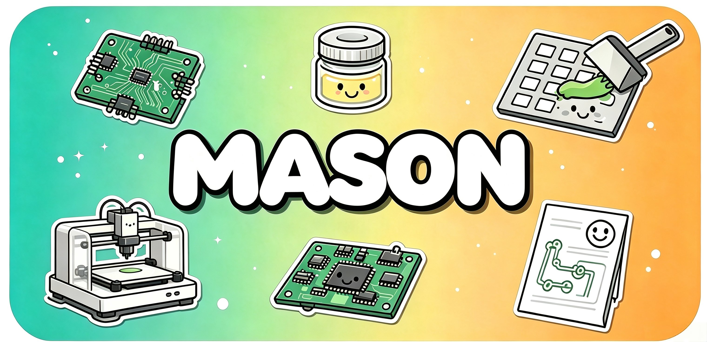

<div align="center">



#  Mason

**Gerber에서 3D 출력 스텐실까지 — PCB 솔더 페이스트 인쇄 도구를 한 번에 생성**
*Gerber 분석 · 매개변수 기반 CAD · 실시간 3D 미리보기 · 로컬 처리*

[🌐 웹사이트](https://ningzixi.github.io/mason/) · [📝 변경 기록](https://github.com/NingZiXi/mason/releases) · [🐛 문제 제보](https://github.com/NingZiXi/mason/issues) · [👤 개발자](https://github.com/NingZiXi)

[简体中文](./README.zh-CN.md) · [English](./README.md) · [日本語](./README.ja.md) · [한국어](./README.ko.md)

[](https://github.com/NingZiXi/mason/actions/workflows/ci.yml) [](./LICENSE) [](https://tauri.app) [](https://vuejs.org) [](https://www.rust-lang.org) [](https://www.python.org) [](#개발-환경)

### ⬇️ 다운로드

[](https://github.com/NingZiXi/mason/releases/latest) [](https://github.com/NingZiXi/mason/releases/latest) [](https://github.com/NingZiXi/mason/releases/latest)

> [Releases](https://github.com/NingZiXi/mason/releases/latest)에서 Windows x64, macOS Apple Silicon 또는 Linux x64 설치 파일을 받으세요. 실제 제공 파일은 각 릴리스를 확인하세요. 모델링 엔진이 포함되어 있어 Python을 별도로 설치할 필요가 없습니다.

</div>

---

## 📌 소개

**Mason**은 Tauri 2 + Python(build123d)으로 만든 데스크톱 앱입니다. PCB 제작용 Gerber ZIP에서 3D 출력 가능한 솔더 페이스트 인쇄 도구를 생성합니다. 시제품부터 소량 제작까지 두 가지 모드를 제공합니다.

- **스텐실 지그 모드** — PCB 트레이, B면 베이스, A면 상단 커버를 생성합니다. 베이스와 커버 사이에 금속 스텐실을 고정하고, 트레이의 위치 결정 기둥 4개를 따라 조립체를 내려놓습니다.
- **PCB 스텐실 모드** — 페이스트 레이어를 바탕으로 PCB 포켓이 있는 일체형 스텐실을 생성합니다. 별도의 지그 없이 시제품 제작에 사용할 수 있습니다.

기본 작업 흐름은 「Gerber 가져오기 → 치수·개구부 확인 → STL 내보내기」입니다. 기본 매개변수에서 시작하고 실제 기판과 프린터에 맞춰 조정하세요.

---

## ✨ 주요 기능

### Gerber 분석

- 기판 외곽 레이어(`.GKO` / `Edge.Cuts` / `.GM1`)와 페이스트 레이어(`.GTP` / `.GBP`) 자동 인식
- 자체 RS-274X 파서로 `%LM` 반전, `%LR` 회전, `%LS` 배율 변환 지원
- G02/G03 원호, 여러 줄 D 코드, 비정형 기판 외곽 추출 지원
- 원형·직사각형·장원형·둥근 직사각형·다각형·영역 채움 패드 분석
- 동일 기판 배열과 서로 다른 기판이 섞인 패널 지원, 전체 패널 또는 특정 기판 선택
- PCB 스텐실 모드에서 유효한 외곽이 없으면 패드 범위로 추정하며, 추정 상태를 표시하고 내보내기 전에 확인

### 스텐실 지그 모드

- 아래에서부터 **PCB 트레이 → B면 베이스 → 금속 스텐실 → A면 상단 커버** 순서로 조립
- 베이스와 커버의 둘레 나사로 스텐실 고정, 트레이에 일체형으로 생성되는 위치 결정 기둥 4개로 조립체 정렬
- 네 모서리는 나사가 아닌 위치 결정 기둥입니다. 둘레 나사 간격과 M2.5 / M3 / M3.5 / M4 / M5 규격 조정 가능
- 스텐실 크기에 맞춰 지그 크기를 20mm 단위로 계산, 같은 크기의 PCB에는 베이스와 커버 재사용 가능
- 비정형 PCB 외곽 재현 및 PCB 포켓 여유 조정

### PCB 스텐실 모드

- PCB 외곽 프레임, PCB 두께만큼의 포켓, 포켓 바닥의 얇은 스텐실층으로 구성된 일체형 모델
- 개구부는 스텐실층만 관통하며 PCB 외곽 좌표에 맞춰 배치
- 장원형 패드를 직사각형 개구부로 변환
- 테스트 포인트 필터링 기본 활성화: Gerber 용도 속성, 선택적 `FlyingProbeTesting.json`의 부품·핀 정보, 고립된 원형 패드의 기하 특성을 함께 사용합니다. 부품 핀·인접 원형 패드·규칙적인 배열을 보호하며, 결과는 미리보기에서 확인하세요.
- 2D 개구부 확인에서 원본 패드·실제 개구부·겹쳐 보기 비교 및 자동 필터링 사유 표시
- 수동 편집은 **원본 패드**에서만 가능: 왼쪽 클릭·영역 선택으로 열기/닫기/자동 복원, 오른쪽 드래그로 이동, 휠로 확대·축소
- 수동 개구부 편집의 실행 취소·다시 실행 및 전체 패널/개별 기판 간 동기화
- 조밀한 핀의 교차 배치, 큰 개구부의 격자 분할 등 후처리
- 기판 외곽을 따르는 프레임 또는 직사각형 프레임 선택, 모서리 반경 조정
- PCB를 쉽게 꺼낼 수 있는 사다리꼴 홈

### 공통 기능

- three.js 실시간 3D 미리보기, 백그라운드 준비 및 부품 전환 캐시
- 빠른 STL 생성 경로와 캐시로 첫 미리보기 및 반복 편집 대기 시간 감소
- 프리셋: 기본 설정이나 사용자 프리셋에서 새 프리셋으로 저장, 기존 프리셋 갱신·이름 변경·삭제
- 프리셋 전환 시 변경 사항 저장·다른 이름으로 저장·버리기 선택, 재시작 시 마지막으로 선택한 저장된 프리셋 복원
- 프리셋은 출력·구조 매개변수만 저장하며 **기판 크기·두께·Gerber 데이터는 포함하지 않습니다**
- 버튼과 단축키로 매개변수 실행 취소·다시 실행, 연속 편집과 연동 변경은 묶어서 처리
- 전체 조립 미리보기: 분해도, PCB·스텐실 표시 전환, 위치 결정 기둥·둘레 나사·너트 표시
- 평면 고정 영역 미리보기 및 나사·너트의 예상 규격·길이·수량 안내
- 금속 스텐실 치수를 확인하지 않고 내보낼 때 알림, 내보내지 않은 작업을 닫을 때 확인
- 처음 사용 시 간단한 안내, 밝게·어둡게·시스템 테마
- 중국어 간체 / 영어 / 일본어 / 한국어, 직접 선택 또는 시스템 언어 자동 선택. 지원하지 않는 언어는 영어로 표시
- 앱 내 업데이트 확인·설치, 설정에서 시작 시 자동 확인 해제 가능
- STL / STEP 내보내기, 폴더 이름 지정 및 중복 이름에 번호 자동 추가. 모든 부품 생성이 성공한 후 최종 폴더를 만들고, 실패하면 이번 임시 파일을 정리

---

## 🛠️ 개발 환경

### 사전 요구 사항

| 도구 | 버전 | 용도 |
| --- | --- | --- |
| Node.js | 20+ | 프런트엔드 빌드 |
| Rust | stable | Tauri 백엔드 컴파일 |
| Python | 3.12 권장 | CAD 생성, 현재 CI 환경과 일치 |

### 개발 모드 실행

```bash
# 1. Python 의존성 설치
python -m pip install -r python/requirements.txt

# 2. 프런트엔드 의존성 설치 및 실행
npm ci
npm run tauri:dev
```

먼저 [플랫폼별 Tauri 사전 요구 사항](https://v2.tauri.app/start/prerequisites/)을 설치하세요.

개발 모드에서는 PATH와 일반적인 설치 위치에서 Python을 찾습니다. 찾지 못하거나 의존성이 없으면 「Python 환경」에서 경로를 지정하거나 의존성을 설치할 수 있습니다.

### 배포용 빌드

배포 패키지에는 Python + build123d / Shapely / numpy가 포함되므로 사용자가 개발 환경을 준비할 필요가 없습니다.

```bash
# Windows: 내장 Python 런타임 생성
npm run build:python-env

# 데스크톱 앱 패키징
npm run tauri:build
```

macOS / Linux에서는 다음 명령을 사용하세요.

```bash
bash scripts/build-python-env.sh
npm run tauri:build
```

설치 파일은 `src-tauri/target/release/bundle/`에 생성됩니다. Windows는 `.msi` / `.exe` 형식입니다.

> `resources`는 `["resources/python-env"]` 배열 형식을 유지하세요. `{"resources/python-env/**/*": "python-env/"}` 매핑 형식은 `site-packages` 디렉터리 구조를 평탄화하여 의존성을 손상시킵니다.

---

## 📖 사용 방법

### 스텐실 지그 모드

1. Gerber ZIP을 놓아 기판 외곽을 인식합니다. 패널이면 전체 패널 또는 기판 하나를 선택합니다.
2. PCB 크기·두께를 확인하고 금속 스텐실의 **실제 외곽 길이와 너비**를 입력합니다.
3. 필요하면 나사 간격, 트레이 두께, PCB 포켓 여유 등을 조정합니다.
4. PCB 트레이·B면 베이스·A면 상단 커버를 개별 확인하고 전체 조립·분해도와 필요한 나사·너트를 확인합니다.
5. STL / STEP과 저장 위치를 선택하고 내보내기 이름을 확인하면 해당 이름의 하위 폴더에 모델을 저장합니다.

### PCB 스텐실 모드

1. 「PCB 스텐실」 모드로 전환합니다.
2. `.GTP` / `.GBP` 페이스트 레이어를 포함한 Gerber ZIP을 놓습니다.
3. 스텐실층 두께 프리셋을 선택합니다(레진 0.15mm / 표준 0.2mm / FDM 0.3mm).
4. 필요하면 패드 축소율, 프레임 너비, 모서리 반경, PCB 제거 홈 등을 조정합니다.
5. 2D 확인에서 개구부 위치와 필터링 결과를 점검하고 필요하면 수동 편집한 뒤 3D 모델을 확인합니다.
6. 슬라이싱·출력에는 STL, CAD에서 추가 편집하려면 STEP으로 내보냅니다.

---

## 🏗️ 기술 구조

**Vue 3 + Tauri 2(Rust) + Python(build123d)**을 함께 사용합니다.

```text
Vue 3 / Pinia / three.js
       ↕ Tauri IPC
   Rust 프로세스 관리
       ↕ JSON (stdin / stdout)
 Python CAD / build123d + Shapely
       → STL / STEP
```

- 프런트엔드에서 Gerber 분석, 매개변수 편집, 3D 표시를 처리하고 IPC로 Rust에 모델 생성을 요청합니다.
- Rust는 상주 Python 프로세스를 관리하며 줄 단위 JSON 프로토콜로 통신해 반복 시작 비용을 줄입니다.
- 매개변수 해시로 STL을 프런트엔드에 캐시하여 같은 부품의 불필요한 재계산을 줄이고 엔진을 백그라운드에서 준비합니다.
- 패드가 많은 스텐실은 numpy 삼각형 생성과 OCC 평면 메시를 사용하는 빠른 STL 경로로 복잡한 형상 처리 시간을 줄입니다.

### 주요 파일

| 경로 | 역할 |
| --- | --- |
| `python/jig_generator.py` | `build_base` / `build_insert` / `build_cover` / `build_stencil` CAD 형상 생성 |
| `src/lib/gerber/parser.ts` | RS-274X 기판 외곽 파서 |
| `src/lib/gerber/pads.ts` | 페이스트 패드 형상 추출 |
| `src/stores/config.ts` | Pinia 매개변수 상태 |
| `src/components/ModelPreview.vue` | 3D 미리보기 및 STL 캐시 |
| `src/components/StencilForm.vue` | PCB 스텐실 매개변수 |
| `src/components/ConfigForm.vue` | 스텐실 지그 매개변수 |
| `src-tauri/src/commands.rs` | Tauri IPC 명령 |
| `src-tauri/src/scad.rs` | 상주 Python 프로세스 관리 |

---

## 🧪 테스트

프런트엔드, Rust 백엔드, CAD 형상 및 릴리스 정보를 다음 명령으로 확인할 수 있습니다. Python 테스트에는 CAD 의존성이 필요합니다.

```bash
# 프런트엔드 회귀 테스트
npm test -- --run

# 프런트엔드 타입 검사 및 빌드
npm run build

# Rust 컴파일 및 백엔드 테스트
cargo check --manifest-path src-tauri/Cargo.toml
cargo test --manifest-path src-tauri/Cargo.toml --lib

# Python 형상 검증 및 회귀 테스트
python python/tests/run_all.py
python -m pip install pytest
python -m pytest python/test_jig_generator.py -q

# 릴리스 정보 일관성 확인
npm run test:release
```

형상 검증은 나사 배치, 세 부품의 형상과 구멍 위치, 비정형 기판, 스텐실 개구부, 홈의 깊이·방향, B면 육각 너트 자리 등을 다루는 11개 스크립트와 별도 회귀 테스트로 구성됩니다.

GitHub Actions는 `master` 푸시와 PR에서 CI를 실행합니다. 패키징·릴리스 상세 내용은 [개발 문서(영문)](./docs/DEVELOPMENT.en.md)를 참고하세요.

---

## 📁 프로젝트 구조

```text
mason/
├── .github/workflows/ci.yml
├── .github/workflows/release.yml
├── public/
├── scripts/
├── src/
│   ├── components/
│   ├── composables/
│   ├── lib/gerber/
│   ├── i18n/
│   └── stores/
├── src-tauri/
│   └── src/
├── python/
│   ├── jig_generator.py
│   └── tests/
├── docs/
├── test_gerber/
└── README.md
```

`src/`는 앱 UI, `src-tauri/`는 데스크톱 백엔드, `python/`은 CAD 엔진, `docs/`는 웹사이트와 개발 문서입니다.

---

## ❓ 자주 묻는 질문

**Q: Python을 찾지 못한다고 표시됩니다.**

개발 모드는 PATH와 일반적인 설치 위치를 확인합니다. 사용자 지정 경로라면 「Python 환경」에서 선택하고 `python/requirements.txt`의 의존성을 설치하세요. 배포 버전에는 엔진이 포함되어 있습니다.

**Q: Gerber ZIP을 가져올 수 없습니다.**

기판 외곽은 `.GKO` / `.GM1` / `Edge.Cuts`에서 인식하며, PCB 스텐실에는 `.GTP` / `.GBP` 등의 페이스트 레이어가 필요합니다. 이 모드에서 유효한 외곽이 없으면 패드 범위로 추정하므로 내보내기 전에 확인하세요. 분석에 실패하면 ZIP 안의 레이어와 파일 이름을 확인하세요.

**Q: 패드와 개구부가 일치하지 않습니다.**

장원형 패드는 직사각형으로 변환됩니다. 2D 확인에서 자동 필터링·축소·교차 배치·격자 설정을 점검하고 기판 외곽과 페이스트 레이어의 좌표계도 확인하세요.

**Q: 내보낸 파일은 어디에 있나요?**

선택한 위치에 내보내기 이름의 하위 폴더를 만들고 STL / STEP 파일을 저장합니다. 기본 이름은 가져온 파일명이며 수정할 수 있습니다. 같은 이름이 있으면 번호를 추가하여 기존 파일을 보존합니다.

**Q: 자주 쓰는 설정을 저장할 수 있나요?**

프리셋 목록 아래의 「새 프리셋으로 저장」을 사용하세요. 기판 크기·두께·Gerber 데이터는 포함하지 않으며 변경 사항은 직접 저장해야 합니다. 프로젝트 파일 저장·불러오기 기능은 제공하지 않습니다.

**Q: 언어 변경과 업데이트는 어디에 있나요?**

「설정 → 일반」에서 4개 언어 또는 시스템 설정 따르기를 선택할 수 있습니다. 업데이트 확인과 설치는 「정보」에서 할 수 있습니다.

---

## 📄 라이선스

[MIT](./LICENSE)

---

## 🙏 감사의 말

- [build123d](https://github.com/gumyr/build123d) — Python 매개변수 기반 CAD
- [Tauri](https://tauri.app/) — 데스크톱 프레임워크
- [Vue 3](https://vuejs.org/) / [Pinia](https://pinia.vuejs.org/) / [Element Plus](https://element-plus.org/) / [three.js](https://threejs.org/)
- [Shapely](https://github.com/shapely/shapely) — 2D 형상 연산

---

<div align="center">

도움이 되었다면 ⭐ Star로 응원해 주세요.

[](https://github.com/NingZiXi/mason/stargazers)

</div>
